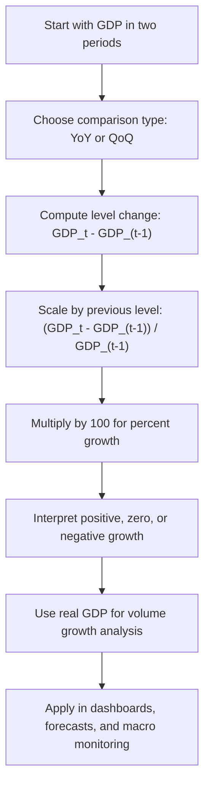

# GDP Growth

$$
\text{GDP Growth Rate}_t = \dfrac{\text{GDP}_t - \text{GDP}_{t-1}}{\text{GDP}_{t-1}} \times 100
$$

We are working on GDP Growth, with canonical formula $\text{GDP Growth Rate}_t = \dfrac{\text{GDP}_t - \text{GDP}_{t-1}}{\text{GDP}_{t-1}} \times 100$, or equivalently as a log difference $\left(\log(\text{GDP}_t) - \log(\text{GDP}_{t-1})\right)\times 100$ as an approximation in percentage terms. The domain is macroeconomic output measurement across time, usually using **real GDP** when the goal is volume growth rather than price-driven nominal changes. Common reporting conventions are year-on-year and quarter-on-quarter growth.

## Deep Breakdown

GDP Growth measures how much total economic output changes from one period to the next. If GDP tells us the size of the economy in a given period, GDP Growth tells us whether that economy is expanding, stagnating, or contracting.

The core intuition is simple:

- compare GDP this period to GDP last period,
- scale that difference relative to the earlier period,
- express it as a percentage.

That gives the percentage increase or decrease in economic output over time.

The standard discrete growth formula is:

$$
\text{GDP Growth Rate}_t = \frac{\text{GDP}_t - \text{GDP}_{t-1}}{\text{GDP}_{t-1}} \times 100
$$

This answers: “How much larger or smaller is GDP in period $t$ relative to period $t-1$?” In macroeconomics, GDP Growth is one of the most important high-level indicators because it summarizes aggregate economic momentum. Governments, firms, investors, central banks, and analysts use it to assess whether the economy is speeding up or slowing down.

A critical distinction is:

- **Nominal GDP growth:** includes both changes in output quantities and changes in prices.
- **Real GDP growth:** isolates volume growth by adjusting for price changes.

When economists discuss “economic growth” in the substantive sense, they usually mean **real GDP growth**, not nominal GDP growth.

Common time comparisons:

- **Year-on-year (YoY):** compare a quarter or year to the same quarter or year one year earlier.
- **Quarter-on-quarter (QoQ):** compare one quarter to the previous quarter.
- **Annualized quarter-on-quarter:** scale quarterly growth to an annual rate, common in some countries.
- **Log growth:** use log differences, especially in statistical modeling and time-series analysis.

Why this matters in DA/DS:

- **Economic dashboards:** growth rates are easier to compare across periods than raw GDP levels.
- **Macro forecasting:** many predictive models target GDP growth instead of GDP levels.
- **Business planning:** firms use GDP growth to estimate market conditions, demand trends, and risk.
- **Cross-country analysis:** percent growth allows comparisons across economies of different sizes.
- **Time-series modeling:** growth rates often behave more stably than raw macro levels.

A useful business interpretation:

- positive GDP growth usually signals economic expansion,
- negative GDP growth signals contraction,
- persistent slowdown in growth can affect hiring, consumer demand, advertising budgets, and investment.

## Flowchart

