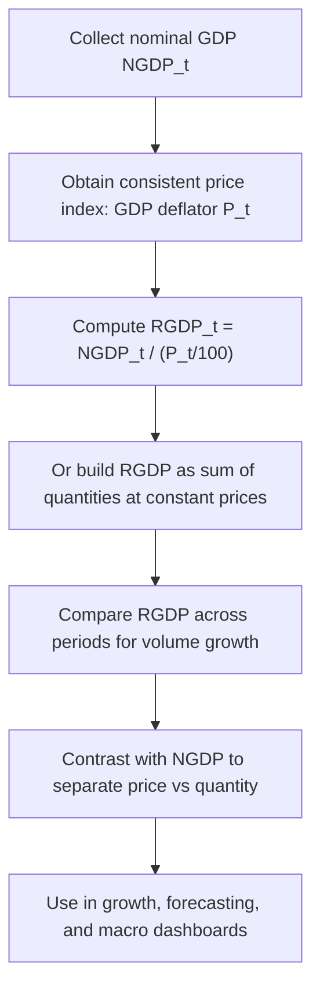

# Real GDP (RGDP)

$$
\mathrm{RGDP}_t = \dfrac{\mathrm{NGDP}_t}{P_t} \times 100
$$

_(GDP deflator form)_ or $\mathrm{RGDP}_t = \sum_i p_{i,b}\, q_{i,t}$ _(constant-price / base-year valuation)_ We are working on **Real Gross Domestic Product**, Real GDP or RGDP, the value of final output measured in **constant prices** so that period-to-period changes reflect **quantities**, not current-price inflation. A common accounting link is

$$
\mathrm{RGDP}_t = \frac{\mathrm{NGDP}_t}{P_t/100},
$$

where $P_t$ is the **GDP deflator** indexed so a base year equals $100$. An equivalent conceptual sum form is

$$
\mathrm{RGDP}_t = \sum_{i} p_{i,b}\, q_{i,t},
$$

valuing period-$t$ quantities $q_{i,t}$ at base-year or fixed prices $p_{i,b}$. National statistical offices often publish chain-weighted volume measures; the algebra below stays at the textbook level.

## Deep Breakdown

**Nominal GDP** mixes price changes and quantity changes. **Real GDP** removes the price-level effect so analysts can discuss **volume growth**, productivity, and recessions without mistaking inflation for higher production.

Three linked objects:

1. **Nominal GDP** $\mathrm{NGDP}_t$: current prices times quantities.
2. **GDP deflator** $P_t$: the price index that reconciles nominal and real GDP.
3. **Real GDP** $\mathrm{RGDP}_t$: NGDP after deflating by $P_t$ (up to index normalization).

Implied deflator relationship (index level form):

$$
P_t = \frac{\mathrm{NGDP}_t}{\mathrm{RGDP}_t} \times 100
\quad\text{(when RGDP is indexed so base year } P_b = 100\text{)}.
$$

**Chain-weighted** real GDP (used in many national accounts) updates weights over time so substitution across goods is handled better than a single fixed base year. The conceptual point for DA/DS is unchanged: Real GDP answers **“how much did we produce?”** rather than **“what was the invoice total?”** Why this matters:

- **Growth rates:** headline “GDP growth” is usually **real** growth.
- **Per-capita metrics:** divide Real GDP by population for living-standard proxies.
- **Fiscal ratios:** debt-to-GDP often uses nominal GDP; interpret carefully.
- **Business analytics:** pair nominal sales trends with a price index before claiming volume gains.

## Flowchart



## Real-world use

### Where it is used

Macro reporting, central-bank briefings, executive dashboards, country comparisons, and any analysis where **inflation must be stripped out** of output series.

### Problem it solves

Raw nominal series rise when **prices** rise even if **volumes** are flat. Real GDP provides a volume-consistent output aggregate.

### How it solves the problem

It re-values output using a price index (deflator) or fixed base-year prices, so the remaining movement is interpreted as real activity.

### Example in a business

A regional sales team sees revenue up 8% YoY. Before attributing success to demand, an analyst deflates revenue with a suitable price index (category CPI or internal price mix index). If “real” revenue grew 1%, most of the headline gain was **pricing**, not **volume**.

## The formula, piece by piece

| Symbol | Meaning |
| --- | --- |
| $\mathrm{RGDP}_t$ | Real GDP in period $t$ (volume-consistent units) |
| $\mathrm{NGDP}_t$ | Nominal GDP in period $t$ (current prices) |
| $P_t$ | GDP price deflator level, base year often $=100$ |
| $q_{i,t}$ | Quantity of final good or service $i$ in period $t$ |
| $p_{i,b}$ | Price of item $i$ in base year $b$ (fixed-price valuation) |

Deflator form (index normalization as in many textbooks):

$$
\mathrm{RGDP}_t = \frac{\mathrm{NGDP}_t}{P_t / 100}
$$

Fixed-base sum form (conceptual):

$$
\mathrm{RGDP}_t = \sum_{i=1}^{m} p_{i,b}\, q_{i,t}
$$

Growth rate from real levels:

$$
\text{Real GDP Growth}_t = \frac{\mathrm{RGDP}_t - \mathrm{RGDP}_{t-1}}{\mathrm{RGDP}_{t-1}} \times 100
$$

## The formula in words

**Deflator route:** divide nominal GDP by the overall price level of domestically produced output. What remains is “GDP as if prices had not changed relative to the index definition.” **Constant-price route:** multiply each produced quantity by a **frozen** price from a chosen base year, then add. That mimics measuring today’s physical output with yesterday’s price tags. **Growth route:** once $\mathrm{RGDP}$ is on a consistent basis, percentage changes approximate **volume growth** (up to index revision and chain-weighting details).

## Critical Concepts

- **Real $\neq$ nominal.** Never infer production growth from NGDP alone.
- **GDP deflator $\neq$ CPI.** Both are price indices but cover different baskets and uses.
- **Base years and rebasing** shift levels but should leave **growth rates** consistent if done properly.
- **Chain weighting** improves substitution handling versus a single fixed base; published “real GDP” is often chain-weighted volume.
- **Revisions** in national accounts can change historical real GDP as methods improve.

## Step-by-step calculation (tiny example)

Suppose for one period:

$$
\mathrm{NGDP}_t = 1100,\quad P_t = 125
$$

with the deflator normalized so $100$ corresponds to a reference period.

### Step 1, write the deflator conversion

$$
\mathrm{RGDP}_t = \frac{1100}{125/100} = \frac{1100}{1.25} = 880
$$

### Step 2, interpret Nominal GDP is 1100, but after deflating by the price level the **volume-consistent** GDP is 880 in real units relative to the index definition.

## Code examples

### Beginner example (Python)

```python
ngdp = 1100.0
deflator = 125.0   # index
level, base = 100
rgdp = ngdp / (deflator / 100.0)
print("Real GDP (conceptual units):", round(rgdp, 2))
```

### Beginner example (R)

```r
ngdp <- 1100.0
deflator <- 125.0
rgdp <- ngdp / (deflator / 100.0)
cat("Real GDP (conceptual units):", round(rgdp, 2), "\n")
```

### Professional example (Python)

```python
from __future__ import annotations
import pandas as pd
RANDOM_SEED = 42

def add_real_gdp( frame: pd.DataFrame, ngdp_col: str = "ngdp", deflator_col: str = "gdp_deflator", out_col: str = "rgdp",
) -> pd.DataFrame:
    """Compute real GDP from nominal GDP and a GDP deflator (index, base 100)."""
    result = frame.copy()
    result[out_col] = result[ngdp_col] / (result[deflator_col] / 100.0)
    return result

def main() -> None:
    rng = pd.Series(range(4))
    _ = RANDOM_SEED   # reserved for reproducible extensions (e.g. synthetic data)
    df = pd.DataFrame( { "quarter": ["Q1", "Q2", "Q3", "Q4"], "ngdp": [1000.0, 1020.0, 1055.0, 1080.0], "gdp_deflator": [100.0, 101.0, 103.0, 104.0], } )
    out = add_real_gdp(df)
    print(out)

if __name__ == "__main__":
    main()
```

## Self-check: mathematical verification

From $\mathrm{RGDP}_t = \mathrm{NGDP}_t / (P_t/100)$, multiply both sides by $P_t/100$ to recover $\mathrm{NGDP}_t = \mathrm{RGDP}_t \times (P_t/100)$. Dimensions: if $P$ is an index, $\mathrm{RGDP}$ inherits the **same currency units** as nominal GDP divided by a pure number scaling from the index definition, consistent with national-accounts practice.

## Common Pitfalls and Edge Cases

- Using **CPI** when the question requires the **GDP deflator**.
- Comparing **real levels** across countries without checking units and base years.
- Treating **revised** real GDP as immutable truth; vintage matters in backtests.
- Ignoring **seasonal adjustment** when comparing adjacent quarters.

## References and Standard Results

- National accounts: nominal vs real GDP; expenditure and output approaches.
- GDP deflator definition: implicit price level of domestically produced GDP.
- Chain-weighted real GDP in modern national accounts (e.g. BEA, Eurostat methods).
