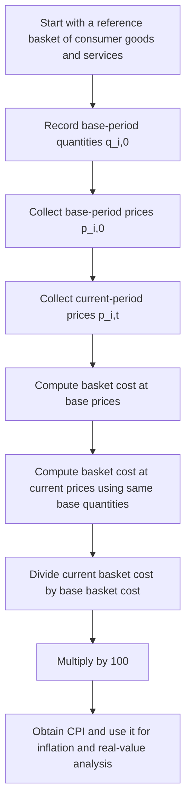

# Consumer Price Index, CPI

$$
\mathrm{CPI}=\left(\frac{\text{Cost of Basket in Current Period}}{\text{Cost of Basket in Base Period}}\right)\times 100
$$

We are working on the **Consumer Price Index**, CPI, defined by

$$
\mathrm{CPI}=\left(\frac{\text{Cost of Basket in Current Period}}{\text{Cost of Basket in Base Period}}\right)\times 100,
$$

where the basket is a fixed reference basket of consumer goods and services. This is a Laspeyres-type price index used to measure consumer-price inflation relative to a base period. It is central to inflation analysis, real-versus-nominal adjustments, macro dashboards, and price deflation.

## Deep Breakdown

The Consumer Price Index, CPI, is one of the main measures of inflation in an economy. It tracks how the cost of a representative basket of consumer goods and services changes over time. The core intuition is simple: > If households buy a typical bundle of goods and services, how much more expensive or cheaper is that same bundle today compared with a base period? That is exactly what the CPI formula measures. If the basket costs more in the current period than it did in the base period, CPI rises above 100. If it costs exactly the same, CPI equals 100. If it costs less, CPI falls below 100. This is why the CPI is usually interpreted as an **index number**, not as a currency amount.

The standard formula is:

$$
\mathrm{CPI}=\left(\frac{\text{Cost of Basket in Current Period}}{\text{Cost of Basket in Base Period}}\right)\times 100
$$

The basket is usually built from consumer expenditure data and includes categories such as:

- food,
- housing,
- transport,
- clothing,
- healthcare,
- education,
- utilities,
- recreation.

The basket is intended to approximate typical household consumption patterns, though the exact composition depends on the statistical agency.

## Why it is called a Laspeyres-type index

A Laspeyres-type price index uses **base-period quantities** as weights. That means the basket composition is fixed using reference-period consumption patterns, and only prices are allowed to change when computing the index. If there are goods $i=1,\dots,n$, then a more explicit form is:

$$
\mathrm{CPI}_t=\left(
\frac{\sum_{i=1}^{n} p_{i,t} q_{i,0}}
{\sum_{i=1}^{n} p_{i,0} q_{i,0}}
\right)\times 100
$$

where:

- $p_{i,t}$ is the current-period price of item $i$,
- $p_{i,0}$ is the base-period price of item $i$,
- $q_{i,0}$ is the base-period quantity weight.

So CPI asks: > What would it cost today to buy the base-period basket? This is useful because it isolates price change while holding basket composition fixed.

## Why CPI matters CPI is used for

- inflation tracking,
- wage and pension indexation,
- real-income adjustment,
- macroeconomic dashboards,
- monetary policy,
- converting nominal values into real values.

For example, if nominal wages rose by 5% but CPI rose by 7%, then real purchasing power likely fell.

## Link to inflation rate CPI itself is a level index. Inflation is usually calculated from the percentage change in CPI

$$
\mathrm{Inflation\ Rate}=
\left(
\frac{\mathrm{CPI}_t-\mathrm{CPI}_{t-1}}
{\mathrm{CPI}_{t-1}}
\right)\times 100
$$

So:

- CPI tells you the price index level,
- inflation rate tells you how fast that index is changing.

## Important limitations CPI is extremely useful, but it is not perfect.

Common issues include:

- **substitution bias**, because consumers may change what they buy when prices change,
- **quality adjustment challenges**, because products improve or change over time,
- **new-product bias**, because new consumption categories may enter late,
- **household heterogeneity**, because different households face different spending patterns.

So CPI is a practical standardized measure of consumer-price inflation, not a perfect personalized cost-of-living measure for every household.

For DA/DS work, CPI is often used in:

- economic reporting dashboards,
- inflation-adjusted revenue analysis,
- real wage calculations,
- nominal-to-real transformations,
- macro feature engineering for forecasting models.

## Flowchart



## Real-world use

### Where it is used

CPI is used in inflation monitoring, cost-of-living analysis, central-bank policy work, labor contract indexation, macro dashboards, and business planning.

### Problem it solves

It solves the problem of summarizing many consumer-price movements into one standardized price index. Without such an index, it would be difficult to track broad inflation consistently over time.

### How it solves the problem

It fixes a representative basket of goods and services, prices that basket in the base period and current period, then expresses the current cost relative to the base cost as an index with base 100.

### Example in a business

Suppose a retail analyst builds a dashboard comparing nominal sales growth with inflation. CPI can be used as a deflator to determine whether revenue growth reflects higher prices, higher real volume, or both. A macro analyst may also use CPI as an input feature in forecasting or in adjusting wages, costs, or contract values into real terms.

## The formula, piece by piece

| Symbol | Meaning |
| --- | --- |
| $\mathrm{CPI}$ | Consumer Price Index |
| $p_{i,t}$ | Price of item $i$ in current period $t$ |
| $p_{i,0}$ | Price of item $i$ in base period |
| $q_{i,0}$ | Base-period quantity weight for item $i$ |
| $t$ | Current period |
| $0$ | Base period |
| $\sum_{i=1}^{n} p_{i,t} q_{i,0}$ | Cost of base basket at current prices |
| $\sum_{i=1}^{n} p_{i,0} q_{i,0}$ | Cost of base basket at base prices |

Canonical basket-ratio formula:

$$
\mathrm{CPI}=\left(\frac{\text{Cost of Basket in Current Period}}{\text{Cost of Basket in Base Period}}\right)\times 100
$$

Explicit Laspeyres-type form:

$$
\mathrm{CPI}_t=\left(
\frac{\sum_{i=1}^{n} p_{i,t} q_{i,0}}
{\sum_{i=1}^{n} p_{i,0} q_{i,0}}
\right)\times 100
$$

Base-period normalization:

$$
\mathrm{CPI}_0 = 100
$$

Inflation-rate link:

$$
\mathrm{Inflation\ Rate}_t=
\left(
\frac{\mathrm{CPI}_t-\mathrm{CPI}_{t-1}}
{\mathrm{CPI}_{t-1}}
\right)\times 100
$$

## The formula in words

Take the fixed consumer basket and ask two questions: 1. how much did it cost in the base period?
2. how much does that same basket cost now?

Then divide the current cost by the base cost and multiply by 100. If the basket now costs 20% more than in the base period, CPI will be 120. If it costs 5% less, CPI will be 95. If the cost is unchanged, CPI will be 100. So CPI expresses the current consumer-basket cost as a percentage of the base-period basket cost.

## Critical Concepts

- **CPI is an index number, not a direct price level.** It measures relative change from the base period.
- **The basket is fixed in quantity terms in the Laspeyres setup.** This isolates price changes while holding basket composition constant.
- **Base period CPI is normalized to 100.** This is why CPI values are interpreted relative to 100.
- **Inflation is derived from changes in CPI.** CPI level and inflation rate are related but not identical.
- **CPI is a consumer-price measure, not a full GDP-wide price index.** It focuses on household consumption baskets.
- **Real-versus-nominal analysis often uses CPI as a deflator.** This is one of its main business and macro uses.
- **CPI has measurement biases and approximation issues.** It is standardized and useful, but not perfect.

## Step-by-step calculation (tiny example)

Suppose the base-period basket contains:

- 10 units of bread,
- 5 units of milk.

Base-period prices:

- bread: 2 each,
- milk: 4 each.

Current-period prices:

- bread: 3 each,
- milk: 5 each.

### Step 1, compute basket cost in the base period

$$
\text{Base Basket Cost} = (10 \times 2) + (5 \times 4)
$$

$$
= 20 + 20 = 40
$$

### Step 2, compute the same basket cost in the current period Use the same quantities, but current prices

$$
\text{Current Basket Cost} = (10 \times 3) + (5 \times 5)
$$

$$
= 30 + 25 = 55
$$

### Step 3, compute CPI

$$
\mathrm{CPI}=\left(\frac{55}{40}\right)\times 100
$$

$$
=1.375 \times 100 = 137.5
$$

### Interpretation The consumer basket now costs 37.5% more than in the base period.

### Tiny plain-language reading

What cost 40 in the base period now costs 55, so the CPI is 137.5.

### Inflation link example

If the previous period CPI was 130 and the current CPI is 137.5, then inflation is:

$$
\left(\frac{137.5-130}{130}\right)\times 100
=
\left(\frac{7.5}{130}\right)\times 100
\approx 5.77\%
$$

## Code examples

### Beginner friendly Example \[Python\])

```python
# CPI from basket costs
base_basket_cost = 40
current_basket_cost = 55
cpi = (current_basket_cost / base_basket_cost) * 100
print("CPI:", cpi)
```

Explanation
:

- `current_basket_cost / base_basket_cost` gives the relative basket cost.
- Multiplying by 100 converts that ratio into an index.

Manual check:

$$
\left(\frac{55}{40}\right)\times 100 = 137.5
$$

### Beginner friendly Example \[R\])

```r
# CPI from basket costs
base_basket_cost <- 40
current_basket_cost <- 55
cpi <- (current_basket_cost / base_basket_cost) * 100
cat("CPI:", cpi, "\n")
```

Explanation
:

- This directly applies the CPI formula to basket costs.
- It is the simplest index-number implementation.

### Final Professional Example \[Python\])

```python
# Reference example with a numerical check.
import math

def cpi(quantities, base_prices, current_prices):
    if not quantities or not len(quantities) == len(base_prices) == len(current_prices):
        raise ValueError("Basket arrays must be equally sized and nonempty.")
    if any(x < 0 for values in (quantities, base_prices, current_prices) for x in values):
        raise ValueError("Quantities and prices must be nonnegative.")
    base_cost = sum(q * p for q, p in zip(quantities, base_prices))
    if base_cost == 0:
        raise ValueError("The base basket must have positive cost.")
    return 100 * sum(q * p for q, p in zip(quantities, current_prices)) / base_cost

index = cpi([2, 1], [10, 20], [12, 22])
assert math.isclose(index, 115)
print("Fixed-basket CPI:", index)
print("Price increase since base period (%):", index - 100)
```

Base-period quantities hold the basket fixed while prices change. The base index is 100; an index of 115 means a 15% basket price increase, not a 115% increase.

## Self-check: mathematical verification

### Re-derivation from the basket-cost idea

Let the fixed consumer basket be defined by base-period quantities $q_{i,0}$.

The cost of that basket in the base period is:

$$
\sum_{i=1}^{n} p_{i,0} q_{i,0}
$$

The cost of the same basket in current period $t$ is:

$$
\sum_{i=1}^{n} p_{i,t} q_{i,0}
$$

A price index compares current basket cost to base basket cost, so:

$$
\mathrm{CPI}_t=
\left(
\frac{\sum_{i=1}^{n} p_{i,t} q_{i,0}}
{\sum_{i=1}^{n} p_{i,0} q_{i,0}}
\right)\times 100
$$

This matches the canonical CPI formula exactly.

### Base-period normalization check

If the current period equals the base period, then:

$$
p_{i,t}=p_{i,0}
$$

for all $i$. Therefore numerator and denominator are equal, so:

$$
\mathrm{CPI}_0=
\left(
\frac{\sum_{i=1}^{n} p_{i,0} q_{i,0}}
{\sum_{i=1}^{n} p_{i,0} q_{i,0}}
\right)\times 100
=100
$$

So the base-period normalization is correct.

### Inflation-rate link check

If CPI changes from $\mathrm{CPI}_{t-1}$ to $\mathrm{CPI}_t$, the percentage change is:

$$
\left(
\frac{\mathrm{CPI}_t-\mathrm{CPI}_{t-1}}
{\mathrm{CPI}_{t-1}}
\right)\times 100
$$

This is the standard inflation-rate definition derived from CPI levels.

### Unit check

Both numerator and denominator in the CPI ratio are basket costs in currency units, so the ratio is unitless:

$$
\frac{\text{currency}}{\text{currency}}=1
$$

Multiplying by 100 converts the unitless ratio into an index number. This is consistent.

### Why the Laspeyres structure is fixed-weight

The quantities $q_{i,0}$ are held fixed from the base period. That means the formula is isolating price movement rather than allowing basket composition to change simultaneously. This confirms the Laspeyres-type interpretation in the prompt.

### Verbal-to-algebra consistency

The verbal explanation says CPI compares the current cost of a fixed consumer basket with the base-period cost of that same basket. The algebra shows exactly that.

## Common Pitfalls and Edge Cases

- **Confusing CPI level with inflation rate:** CPI is an index level, while inflation is the percentage change in that index.
- **Ignoring the fixed-basket assumption:** CPI is based on a reference basket, not a constantly re-optimized household basket.
- **Treating CPI as a perfect cost-of-living measure for everyone:** Different households face different spending patterns.
- **Forgetting substitution effects:** Consumers may switch toward cheaper goods when relative prices change.
- **Ignoring quality adjustments:** Product quality changes can complicate pure price comparison.
- **Using inconsistent base periods:** CPI values depend on the chosen base normalization.
- **Confusing CPI with broader deflators:** CPI focuses on household consumption, while other price indices cover wider parts of the economy.
- **Deflating nominal values with the wrong index:** The appropriate deflator depends on the variable being adjusted.

## References and Standard Results

- CPI basket-ratio definition, $\mathrm{CPI}=\left(\frac{\text{Cost of Basket in Current Period}}{\text{Cost of Basket in Base Period}}\right)\times 100$
- Laspeyres-type price-index form, $\mathrm{CPI} *t=\left(\frac{\sum p* {i,t}q_{i,0}}{\sum p_{i,0}q_{i,0}}\right)\times 100$
- Base-period normalization, $\mathrm{CPI}_0=100$
- Inflation-rate definition from CPI percentage change
- Real-versus-nominal distinction using price deflators
- Fixed-weight consumer basket interpretation
- Role of CPI in macro dashboards and inflation monitoring
