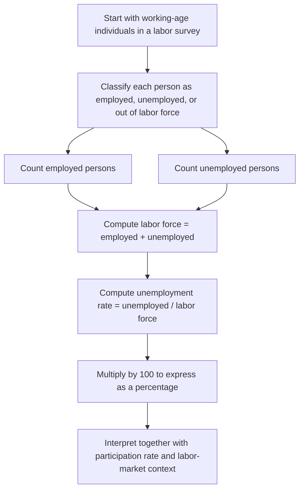

# Unemployment Rate

$$
\mathrm{Unemployment\ Rate}=\left(\frac{\mathrm{Unemployed}}{\mathrm{Labor\ Force}}\right)\times 100
$$

We are working on the **unemployment rate**, defined by

$$
\mathrm{Unemployment\ Rate}=\left(\frac{\mathrm{Unemployed}}{\mathrm{Labor\ Force}}\right)\times 100,
$$

where

$$
\mathrm{Labor\ Force}=\mathrm{Employed}+\mathrm{Unemployed}.
$$

This is a standard macro labor-market percentage under ILO/OECD-style definitions. It measures the share of the labor force that is without work but actively seeking and available for work. It is a core labor-market indicator used in macro dashboards, policy analysis, and business monitoring.

## Deep Breakdown

The unemployment rate is one of the most widely reported labor-market indicators in macroeconomics. It tells us what fraction of the labor force is unemployed at a given time. The key idea is that the unemployment rate is **not** calculated over the total population. It is calculated over the **labor force**. This is crucial.

The labor force includes only people who are:

- employed, or
- unemployed under the standard definition, meaning they do not currently have a job, are available for work, and are actively seeking work.

So the unemployment rate measures joblessness **among labor-market participants**, not among everyone in the country.

The standard formula is:

$$
\mathrm{Unemployment\ Rate}=\left(\frac{\mathrm{Unemployed}}{\mathrm{Labor\ Force}}\right)\times 100
$$

and the labor force is:

$$
\mathrm{Labor\ Force}=\mathrm{Employed}+\mathrm{Unemployed}
$$

This means a person who is not working is not automatically counted as unemployed. If they are not actively looking for work, they are usually classified as **out of the labor force**, not unemployed. Examples of people often outside the labor force:

- many full-time students,
- many retirees,
- some homemakers,
- discouraged workers who stopped actively searching,
- people unable to work under the survey definition.

This is why the unemployment rate can sometimes look lower than people expect. A weak labor market can push some people out of active search, which lowers the measured labor force and can keep the unemployment rate from rising as much as intuition suggests. This is also why the unemployment rate is often analyzed together with:

- **labor force** level,
- **labor force participation rate**,
- **employment-to-population ratio**,
- broader labor underutilization measures. Under ILO/OECD-style standards, the unemployment concept usually requires three conditions: 1. the person is without work,
2. the person is available for work,
3. the person is actively seeking work.

That standardization matters because it allows comparison across countries and across time, at least in principle. For DA/DS and business operations, the unemployment rate is useful because it acts as a macro indicator of labor-market slack and economic conditions.

It often informs:

- labor market dashboards,
- demand forecasting,
- salary benchmarking,
- workforce planning,
- policy analysis,
- macroeconomic nowcasting. A rising unemployment rate often signals weaker labor demand and slower economic activity. A falling unemployment rate often signals tighter labor markets, stronger demand for labor, and potentially wage pressure.

But interpretation always requires context, because changes can come from movements in employment, unemployment, or labor-force participation.

## Flowchart



## Real-world use

### Where it is used

The unemployment rate is used in macroeconomic analysis, labor-market reporting, policy dashboards, central-bank monitoring, economic forecasting, and business planning.

### Problem it solves

It solves the problem of summarizing labor-market slack into one standardized percentage. Without it, comparing joblessness across periods, regions, or countries would be much harder.

### How it solves the problem

It divides the number of unemployed persons by the total labor force, then multiplies by 100. This expresses unemployment as the share of active labor-market participants who do not currently have work but are seeking it.

### Example in a business

Suppose a staffing firm or retail company tracks macro conditions across regions. A rising unemployment rate may signal weaker consumer demand but potentially easier hiring conditions. A falling unemployment rate may indicate stronger household income conditions but tighter hiring markets and upward wage pressure. A business analyst might combine unemployment data with participation and wage indicators to support operational planning.

## The formula, piece by piece

| Symbol | Meaning |
| --- | --- |
| $\mathrm{Unemployed}$ | Number of unemployed persons |
| $\mathrm{Employed}$ | Number of employed persons |
| $\mathrm{Labor\\ Force}$ | Total active labor-market participants |
| $\mathrm{Unemployment\\ Rate}$ | Share of labor force that is unemployed, in percent |

Canonical formula:

$$
\mathrm{Unemployment\ Rate}=\left(\frac{\mathrm{Unemployed}}{\mathrm{Labor\ Force}}\right)\times 100
$$

Labor force identity:

$$
\mathrm{Labor\ Force}=\mathrm{Employed}+\mathrm{Unemployed}
$$

Equivalent expanded formula:

$$
\mathrm{Unemployment\ Rate}
=
\left(
\frac{\mathrm{Unemployed}}
{\mathrm{Employed}+\mathrm{Unemployed}}
\right)\times 100
$$

Range under valid definitions:

$$
0 \le \mathrm{Unemployment\ Rate} \le 100
$$

## The formula in words

Take the number of unemployed people. Divide it by the labor force, which is the total number of people who are either employed or unemployed under the standard definition. Then multiply by 100 to convert the ratio into a percentage. A higher unemployment rate means a larger share of labor-market participants are without work. A lower unemployment rate means a smaller share of labor-market participants are without work. But the result only reflects the labor force, not the full population. That is why the unemployment rate must be interpreted together with participation and employment measures.

## Critical Concepts

- **The denominator is the labor force, not the population.** This is the most important conceptual point.
- **Unemployment requires active job search under standard definitions.** Not everyone without a job is counted as unemployed.
- **Labor force equals employed plus unemployed.** People outside the labor force are excluded.
- **The unemployment rate can move because of participation changes.** A falling labor force can alter the rate even without strong job creation.
- **It is a standardized labor metric.** ILO/OECD definitions help international comparability.
- **A low unemployment rate does not automatically mean a strong labor market.** It may coexist with low participation or weak hours worked.
- **The unemployment rate is often paired with participation rate and employment-to-population ratio.** These complementary measures help avoid misinterpretation.

## Step-by-step calculation (tiny example)

Suppose a country or region has:

- Employed = 920
- Unemployed = 80

### Step 1, compute the labor force

$$
\mathrm{Labor\ Force}=\mathrm{Employed}+\mathrm{Unemployed}=920+80=1000
$$

### Step 2, divide unemployed by labor force

$$
\frac{\mathrm{Unemployed}}{\mathrm{Labor\ Force}}=\frac{80}{1000}=0.08
$$

### Step 3, convert to percentage

$$
0.08 \times 100 = 8
$$

So:

$$
\mathrm{Unemployment\ Rate}=8\%
$$

### Interpretation Eight percent of the labor force is unemployed.

### Tiny plain-language reading

Out of every 100 active labor-market participants, 8 are unemployed.

### Why denominator choice matters

Suppose the total population is 1,500, not 1,000. The unemployment rate is still based on the 1,000 people in the labor force, not the 1,500 total people.

So the rate remains 8%, not:

$$
\frac{80}{1500}\times 100
$$

That second number would be a different statistic and would not be the unemployment rate.

## Code examples

### Beginner friendly Example \[Python\])

```python
# Unemployment rate from employed and unemployed counts
employed = 920
unemployed = 80
labor_force = employed + unemployed
unemployment_rate = (unemployed / labor_force) * 100
print("Labor force:", labor_force)
print("Unemployment rate:", unemployment_rate)
```

Explanation
:

- `labor_force` is the sum of employed and unemployed people.
- `unemployed / labor_force` gives the jobless share of the labor force.
- Multiplying by 100 converts the share to a percentage.

Manual check:

$$
\left(\frac{80}{1000}\right)\times 100 = 8\%
$$

### Beginner friendly Example \[R\])

```r
# Unemployment rate from employed and unemployed counts
employed <- 920
unemployed <- 80
labor_force <- employed + unemployed
unemployment_rate <- (unemployed / labor_force) * 100
cat("Labor force:", labor_force, "\n")
cat("Unemployment rate:", unemployment_rate, "\n")
```

Explanation
:

- `labor_force` is built from employed plus unemployed.
- The percentage formula matches the macro definition exactly.

### Final Professional Example \[Python\])

```python
# Reference example with a numerical check.
import math

def unemployment_rate(employed, unemployed):
    if employed < 0 or unemployed < 0 or employed + unemployed == 0:
        raise ValueError("Require nonnegative counts and a positive labor force.")
    return unemployed / (employed + unemployed)

periods = [("January", 950, 50), ("February", 960, 40)]
rates = [unemployment_rate(employed, unemployed) for _, employed, unemployed in periods]
assert math.isclose(rates[0], 0.05)
for (period, _, _), rate in zip(periods, rates):
    print(f"{period}: {100 * rate:.2f}%")
print(f"Change: {100 * (rates[1] - rates[0]):.2f} percentage points")
```

The denominator is employed plus unemployed, excluding people outside the labor force. Rates are stored as fractions; multiplying a difference by 100 expresses the change in percentage points.

## Self-check: mathematical verification

### Re-derivation from the labor-force definition

The labor force is defined as:

$$
\mathrm{Labor\ Force}=\mathrm{Employed}+\mathrm{Unemployed}
$$

The unemployment rate is the share of labor-force participants who are unemployed.

Therefore:

$$
\mathrm{Unemployment\ Rate}
=
\left(
\frac{\mathrm{Unemployed}}{\mathrm{Labor\ Force}}
\right)\times 100
$$

Substituting the labor-force identity gives:

$$
\mathrm{Unemployment\ Rate}
=
\left(
\frac{\mathrm{Unemployed}}
{\mathrm{Employed}+\mathrm{Unemployed}}
\right)\times 100
$$

This matches the canonical and expanded formulas exactly.

### Range check

Under valid definitions:

- unemployed count is non-negative,
- labor force is non-negative,
- unemployed cannot exceed labor force.

So:

$$
0 \le \frac{\mathrm{Unemployed}}{\mathrm{Labor\ Force}} \le 1
$$

Multiplying by 100 gives:

$$
0 \le \mathrm{Unemployment\ Rate} \le 100
$$

This confirms the stated range.

### Edge-case check If

$$
\mathrm{Labor\ Force}=0
$$

then the formula is undefined because division by zero is impossible. So a valid unemployment rate requires a positive labor force. This is consistent with the implementation checks in the code.

### Unit check

The unemployed count and labor-force count are both measured in persons.

Their ratio is unitless:

$$
\frac{\text{persons}}{\text{persons}} = 1
$$

Multiplying by 100 expresses the result as a percentage. So the units are consistent.

### Verbal-to-algebra consistency

The verbal explanation says the unemployment rate is the share of the labor force that is unemployed, not the share of the total population. Algebraically, the denominator is labor force, not population, which matches the explanation.

## Common Pitfalls and Edge Cases

- **Using total population as the denominator:** That is not the unemployment rate.
- **Counting all non-working people as unemployed:** Standard definitions require active job search and availability.
- **Ignoring labor-force participation changes:** The unemployment rate can move because the labor force changes, not only because jobs change.
- **Treating a low unemployment rate as automatically healthy:** Low participation can hide labor-market weakness.
- **Ignoring broader underemployment or slack measures:** Some labor-market stress is not captured by the headline unemployment rate.
- **Comparing countries without checking definitions and survey methods:** Standardization helps, but implementation details can still matter.
- **Using inconsistent time periods or population bases:** Counts must come from the same reference period and classification system.
- **Forgetting that unemployment is a stock measure at a point or short period, not a full narrative of labor dynamics:** Flows into and out of employment also matter.

## References and Standard Results

- Unemployment-rate definition, $\mathrm{Unemployment\\ Rate}=\left(\frac{\mathrm{Unemployed}}{\mathrm{Labor\\ Force}}\right)\times 100$
- Labor-force identity, $\mathrm{Labor\\ Force}=\mathrm{Employed}+\mathrm{Unemployed}$
- ILO/OECD-style labor-market classification
- Range property of a ratio-based percentage
- Distinction between unemployment rate and participation rate
- Labor market dashboard interpretation using headline unemployment
- Generalization that denominator choice determines metric meaning

## Source-note history

The identical `unemployment_rate_delta_ue` note was consolidated here. Its alias and former public URL resolve to this note. The [repository history](https://github.com/RafaelBraga-Kribitz/braga-portfolio-v2/commits/main/vault/Notes/en/07_econ_business/population_and_labor_force_metrics/economic_rates/unemployment_rate_delta_ue.md) retains the source.
