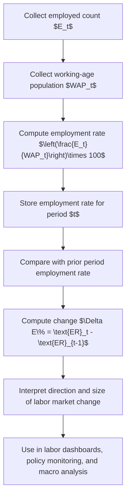

# Employment Rate (ΔE%)

$$
\text{Employment Rate}_t = \left(\frac{E_t}{WAP_t}\right)\times 100,\quad \Delta E\% = \text{Employment Rate}_t - \text{Employment Rate}_{t-1}
$$

We are working on the employment rate, defined as $\text{Employment Rate}_t = \left(\frac{E_t}{WAP_t}\right)\times 100$, where $E_t$ is the number of employed people and $WAP_t$ is the working-age population in period $t$. When the focus is change, we use $\Delta E\% = \text{Employment Rate}_t - \text{Employment Rate}_{t-1}$ for percentage-point change across periods. The setting is labor market measurement under ILO/OECD-style definitions, where the denominator is the working-age population and the metric captures the share of working-age people who are employed.

## Deep Breakdown

The employment rate measures how much of the working-age population is currently employed. It is a broad labor market utilization metric.

Its core formula is:

$$
\text{Employment Rate}_t = \left(\frac{E_t}{WAP_t}\right)\times 100
$$

where:

- $E_t$ is the number of employed persons in period $t$,
- $WAP_t$ is the working-age population in period $t$,
- the multiplication by $100$ expresses the result as a percentage.

This metric answers a simple but important macro question: > Out of all people of working age, what share actually has a job? This is different from the unemployment rate. The unemployment rate looks only inside the labor force:

$$
\text{Unemployment Rate}_t = \left(\frac{U_t}{LF_t}\right)\times 100
$$

where $LF_t = E_t + U_t$. The employment rate uses a broader denominator than the unemployment rate. Because of that, it is often more informative when analysts want to understand overall labor market absorption, not just joblessness among active participants. This matters because labor market conditions can change in two distinct ways: 1. people gain or lose jobs,
2. people enter or leave the labor force.

If many people stop actively seeking work, the unemployment rate can fall even though the labor market is not actually stronger. The employment rate helps reveal that. The notation $\Delta E\%$ is commonly used informally to indicate the change in the employment rate across time. In clean notation, if the employment rate in period $t$ is $\text{ER}_t$, then:

$$
\Delta \text{ER}_t = \text{ER}_t - \text{ER}_{t-1}
$$

If the rates are already expressed as percentages, this difference is measured in **percentage points**, not percent growth.

For example:

- if employment rate rises from $68\%$ to $70\%$, the change is $+2$ percentage points,
- it is not correct to call that “2 percent” unless one explicitly means relative percent change.

A relative rate change can also be defined as:

$$
\%\Delta \text{ER}_t = \left(\frac{\text{ER}_t - \text{ER}_{t-1}}{\text{ER}_{t-1}}\right)\times 100
$$

But in labor dashboards, $\Delta E\%$ usually refers to the level difference in percentage points unless otherwise stated. In DA/DS work, the employment rate is widely used in:

- national and regional labor dashboards,
- policy evaluation,
- demographic segmentation,
- macroeconomic forecasting,
- workforce planning,
- social and economic monitoring.

## Flowchart

