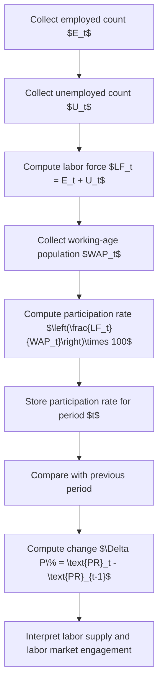

# Participation_rate_delta_p

Participation Rate ($\Delta P\%$)

$$
\text{Participation Rate}_t = \left(\frac{LF_t}{WAP_t}\right)\times 100,\quad \Delta P\% = \text{Participation Rate}_t - \text{Participation Rate}_{t-1}
$$

We are working on the labor force participation rate, defined as $\text{Participation Rate}_t = \left(\frac{LF_t}{WAP_t}\right)\times 100$, where $LF_t$ is the labor force in period $t$ and $WAP_t$ is the working-age population in period $t$. When the focus is change over time, we use $\Delta P\% = \text{Participation Rate}_t - \text{Participation Rate}_{t-1}$, which is usually interpreted as a percentage-point change. The setting is labor market measurement under standard ILO/OECD-style definitions, with labor force defined as employed plus unemployed persons who are actively participating in the labor market.

## Deep Breakdown

The participation rate measures the share of the working-age population that is in the labor force.

The labor force includes:

- people who are employed,
- people who are unemployed but actively seeking and available for work.

So the participation rate answers this question: > Out of all people of working age, what share is economically active in the labor market? The core formula is:

$$
\text{Participation Rate}_t = \left(\frac{LF_t}{WAP_t}\right)\times 100
$$

where:

- $LF_t$ is the labor force in period $t$,
- $WAP_t$ is the working-age population in period $t$.

Since labor force is:

$$
LF_t = E_t + U_t
$$

the participation rate can also be written as:

$$
\text{Participation Rate}_t = \left(\frac{E_t + U_t}{WAP_t}\right)\times 100
$$

This is a key labor market metric because it shows how many working-age people are engaged with the labor market, regardless of whether they currently have a job.

That makes it different from:

- **employment rate**, which measures how many working-age people are employed,
- **unemployment rate**, which measures how many labor-force participants are unemployed.

These three rates are related, but they answer different questions. Participation rate matters because changes in unemployment can be misleading if labor force participation is changing at the same time.

For example:

- unemployment can fall because more people found jobs,
- or unemployment can fall because people stopped looking for work and left the labor force.

The participation rate helps separate those stories. The notation $\Delta P\%$ usually means the change in participation rate over time.

In clean notation:

$$
\Delta \text{PR}_t = \text{PR}_t - \text{PR}_{t-1}
$$

where $\text{PR}_t$ is the participation rate in period $t$. Because the participation rate is already expressed in percent units, this difference is usually measured in **percentage points**, not relative percent growth. If one wants the relative percent change instead, that would be:

$$
\%\Delta \text{PR}_t = \left(\frac{\text{PR}_t - \text{PR}_{t-1}}{\text{PR}_{t-1}}\right)\times 100
$$

But in macro dashboards, $\Delta P\%$ usually refers to the level change in percentage points unless explicitly stated otherwise. In DA/DS contexts, the participation rate is used for:

- labor supply analysis,
- demographic comparisons,
- regional economic monitoring,
- workforce planning,
- policy evaluation,
- understanding aging, education, migration, and retirement effects on labor availability.

## Flowchart

