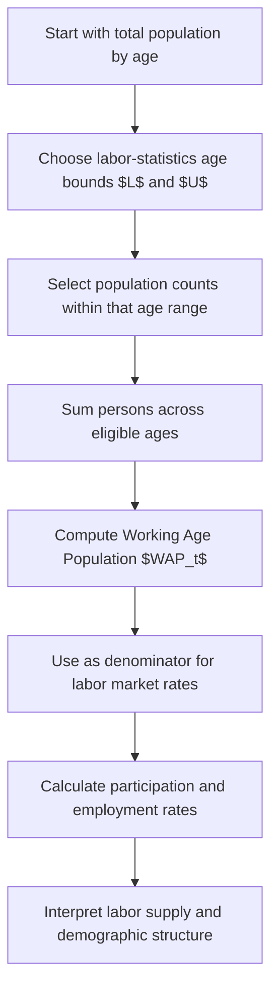

# Working Age Population (WAP)

$$
WAP_t = \sum_{a=L}^{U} N_{a,t}
$$

We are working on Working Age Population, denoted $WAP_t$, the number of people in the age range used for labor force analysis in period $t$. A common accounting form is $WAP_t = \sum_{a=L}^{U} N_{a,t}$, where $N_{a,t}$ is the number of people of age $a$ in period $t$, and $L$ and $U$ are the lower and upper age bounds, such as 15 and 64. The setting is labor force composition under country- or institution-specific age definitions, where Working Age Population is the denominator for participation rate and employment rate.

## Deep Breakdown

Working Age Population, usually abbreviated as WAP, is the population group considered eligible for standard labor force measurement. It is the reference population used to study labor supply, participation, employment, and unemployment. At a high level, WAP answers this question: > Which part of the total population is included in the age window used for labor market analysis? A country does not typically use the entire population as the denominator for labor indicators, because:

- children are generally below working age,
- older age groups may be excluded in some statistical frameworks,
- international comparisons often standardize a particular age interval.

That is why labor statistics often define a specific age band such as:

- 15 and over,
- 15–64,
- 20–64,
- 25–54 for prime-age analysis.

So Working Age Population is not one universal fixed number. It depends on the age definition adopted by the institution or analysis.

A generic accounting formula is:

$$
WAP_t = \sum_{a=L}^{U} N_{a,t}
$$

where:

- $N_{a,t}$ is the number of people aged $a$ in period $t$,
- $L$ is the lower age bound,
- $U$ is the upper age bound.

If the definition is 15–64, then:

$$
WAP_t = \sum_{a=15}^{64} N_{a,t}
$$

If the definition is “15 and over,” then conceptually:

$$
WAP_t = \sum_{a=15}^{\infty} N_{a,t}
$$

or, in finite data, up to the maximum observed age category. This quantity matters because WAP is the denominator in several major labor indicators: Participation Rate:

$$
\text{Participation Rate}_t = \left(\frac{LF_t}{WAP_t}\right)\times 100
$$

Employment Rate:

$$
\text{Employment Rate}_t = \left(\frac{E_t}{WAP_t}\right)\times 100
$$

These rates are sensitive to the definition of WAP. If one country uses 15–64 and another uses 15+, the resulting rates are not automatically comparable. That is why age-range consistency is critical.

In DA/DS work, WAP is used in:

- labor market dashboards,
- demographic segmentation,
- regional workforce analysis,
- public policy monitoring,
- macroeconomic forecasting,
- supply-side analysis of labor availability.

It is a denominator variable, but it is not just a technical detail. Changes in WAP can materially affect the interpretation of participation and employment dynamics.

For example:

- employment may rise in count terms,
- but employment rate may fall if WAP grows faster.

So WAP is essential for grounding labor market metrics in population structure.

## Flowchart

