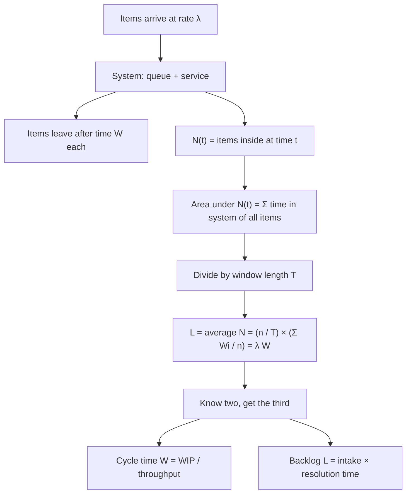

# Little's Law (Queuing Theory)

$$
L = \lambda\, W
$$

, where $L$ is the long-run average number of items in the system (in queue plus in service), $\lambda$ is the long-run average arrival rate (equal to the throughput when the system is stable), and $W$ is the average time an item spends in the system; $\lambda$ and $W$ must use the same time unit.

## Deep Breakdown

What it tells me *(Situation Awareness)*:
Any stable system that items enter and leave (a support queue, a warehouse, a checkout line, a hiring pipeline, a server request pool) obeys one identity between three averages: how many items are inside, how fast they arrive, and how long each stays. The argument is an accounting one. Plot the number of items in the system $N(t)$ over a long window $[0, T]$. The area under that curve can be counted two ways: by time, it is $\bar{N} \cdot T$; by item, it is the sum of every item's time in the system, $\sum_i W_i$. Equating the two and dividing by $T$ gives $\bar{N} = (n/T) \cdot (\tfrac{1}{n}\sum_i W_i) = \lambda W$. Nothing in that argument depends on the arrival distribution, the service distribution, the number of servers or the queue discipline (FIFO, priority, random); it only needs the system to be stable (average arrivals equal average departures) and the window to be long enough that items straddling its edges do not matter. That makes it the most robust law in operations: given any two of $L$, $\lambda$, $W$, the third follows. In DA/DS: estimate cycle time from a WIP snapshot and a throughput count without tracking individual items, sanity-check dashboards (if backlog, intake and resolution time do not satisfy $L \approx \lambda W$, one metric is wrong), and size staff or capacity from target waiting times.

## Flowchart



## Real-world use

### Where it is used

Customer-support backlog planning, warehouse and manufacturing work-in-progress (WIP) control, retail checkout and call-centre staffing, Kanban and software-delivery metrics (WIP limits, lead time), hospital bed occupancy, inventory turnover ($\text{days of inventory} = \text{stock} / \text{daily usage}$), recruitment pipelines, and capacity planning for web servers and database connection pools.

### Problem it solves

Time in system is often the metric that matters (customer wait, order lead time, ticket resolution time) but it is expensive to measure item by item. Counts in the system and arrival rates are cheap: a snapshot and a counter. Little's Law converts the cheap metrics into the expensive one and exposes inconsistent reporting.

### How it solves the problem

Because $L = \lambda W$ holds for averages regardless of distributions, it turns a snapshot into a duration ($W = L / \lambda$) and a target duration into a capacity requirement ($L_{\max} = \lambda W_{\text{target}}$). For a fixed intake, the only way to cut time in system is to cut the number of items in the system, which is the logic behind WIP limits. Combined with a queuing model (for example M/M/c) it also shows how fast $L$ and $W$ grow as utilisation $\rho = \lambda / (c\mu)$ approaches $1$.

### Example in a business

A support desk receives $120$ tickets per day and has $180$ open tickets: average resolution time is $W = 180/120 = 1.5$ days. To meet a 1-day target at the same intake, the open backlog must fall to $120$. A fulfilment centre ships $400$ orders per hour with $1{,}000$ orders in progress on the floor, so the average order spends $2.5$ hours from release to dispatch; capping WIP at $600$ at the same throughput brings that to $1.5$ hours. A supermarket with $5$ tills, $2$ customers per minute and $2$ minutes per customer (utilisation $0.80$) averages $6.2$ customers at the checkout and $3.1$ minutes each; at $2.4$ customers per minute (utilisation $0.96$) the same tills average $26.4$ customers and $11.0$ minutes.

## The formula, piece by piece

- $L$: average number of items in the system over time (time-average of $N(t)$), including those being served; work-in-progress, backlog, occupancy
- $\lambda$: average arrival rate, items per unit time; in a stable system equal to the departure rate (throughput)
- $W$: average time in system per item, from arrival to departure (lead time, cycle time, sojourn time)
- Units: $\lambda$ in items per day with $W$ in days gives $L$ in items; mixing hours and days is the most common error
- Queue-only version: $L_q = \lambda W_q$, with $L_q$ items waiting and $W_q$ time waiting before service
- Service-only version: $L_s = \lambda / \mu$, the average number in service, where $1/\mu$ is the mean service time
- Stability: arrivals and departures balance over the window; for a queue with $c$ servers this requires $\rho = \lambda / (c\mu) < 1$
- Rearrangements: $W = L / \lambda$ and $\lambda = L / W$

## The formula in words

"The average number of things in a system equals how fast they arrive times how long each one stays." Tiny example: a café serves $30$ customers per hour and each stays $20$ minutes ($1/3$ hour) on average, so on average $30 \times 1/3 = 10$ customers are inside.

## Critical Concepts

- **Distribution-free:** the law holds for any arrival process, service-time distribution, number of servers and queue discipline. It does not say *what* $W$ will be, only how $L$, $\lambda$ and $W$ relate.
- **Averages only:** it does not give the distribution of waiting times; a mean of $1.5$ days can hide a tail of tickets open for weeks. Report percentiles separately.
- **Stability required:** if arrivals exceed capacity, the backlog grows without bound and the long-run averages do not exist. Over short windows with a growing or shrinking backlog, use the boundary-corrected form or a longer window.
- **Consistent boundaries:** $L$, $\lambda$ and $W$ must describe the same system (for example, queue plus service, or queue only) and the same population of items.
- **Utilisation drives waiting:** in an M/M/c queue, raising utilisation from $0.80$ to $0.96$ with 5 servers multiplies $L$ by about $4.3$ ($6.22 \to 26.44$) while $\lambda$ rises only by a factor of $1.2$, so by Little's Law $W$ rises by about $3.5$ ($3.11 \to 11.02$ minutes).
- **WIP limits:** for a fixed throughput, lead time is proportional to WIP; reducing work started is the direct lever on lead time (Kanban, CONWIP).
- **Inventory link:** stock on hand $=$ usage rate $\times$ average days in stock, so inventory turnover and days of supply are Little's Law applied to goods (see [[economic_order_quantity_eoq]]).

## Step-by-step calculation (tiny example)

*A support desk logs 10 tickets in a 10-hour day, all closed before the end of the day.*

*Step 1: Arrival rate*
$\lambda = 10 \text{ tickets} / 10 \text{ h} = 1.00$ ticket per hour.

*Step 2: Time in system*
Opened and closed times give durations $1.5, 2.0, 1.0, 3.0, 1.0, 2.0, 2.5, 1.0, 2.0, 1.5$ hours. Sum $= 17.5$ h, so $W = 17.5 / 10 = 1.75$ h.

*Step 3: Apply the law*
$L = \lambda W = 1.00 \times 1.75 = 1.75$ open tickets on average.

*Step 4: Check by direct measurement*
The area under the open-ticket curve $N(t)$ over the day is the sum of the durations, $17.5$ ticket-hours; divided by the $10$-hour window that is $1.75$. Both routes agree exactly because every ticket opens and closes inside the window.

*Step 5: Use it in reverse*
A queue at $120$ tickets per day with a backlog of $180$ implies $W = L / \lambda = 180 / 120 = 1.5$ days.

## Code examples

### Beginner example (Python)

```python
import numpy as np
import pandas as pd

# Support tickets over one 10-hour day: opened and closed times (hours)
tickets = pd.DataFrame({
    "opened": [0.0, 0.5, 1.0, 2.0, 3.0, 4.5, 5.0, 6.0, 7.0, 8.0],
    "closed": [1.5, 2.5, 2.0, 5.0, 4.0, 6.5, 7.5, 7.0, 9.0, 9.5],
})
T = 10.0                                         # observation window (hours)
tickets["time_in_system"] = tickets["closed"] - tickets["opened"]

lam = len(tickets) / T                           # arrival rate (tickets per hour)
W = tickets["time_in_system"].mean()             # average time in system (hours)
print(f"lambda = {lam:.2f} tickets/hour, W = {W:.2f} hours")
print(f"Little's Law: L = lambda * W = {lam * W:.2f} open tickets on average")

# Measure L directly: time-average of the number of open tickets
grid = np.linspace(0, T, 100_001)
open_count = ((tickets["opened"].values[:, None] <= grid) &
              (grid < tickets["closed"].values[:, None])).sum(axis=0)
print(f"Measured time-average L = {open_count.mean():.2f}")

# Rearranged: the average wait implied by a backlog
backlog, rate = 180, 120                         # open tickets, tickets per day
print(f"\nBacklog {backlog} at {rate}/day -> W = L / lambda = {backlog / rate:.1f} days")
```

### Beginner example (R)

```r
opened <- c(0.0, 0.5, 1.0, 2.0, 3.0, 4.5, 5.0, 6.0, 7.0, 8.0)
closed <- c(1.5, 2.5, 2.0, 5.0, 4.0, 6.5, 7.5, 7.0, 9.0, 9.5)
T_window <- 10                          # hours observed

lambda <- length(opened) / T_window     # 1 ticket per hour
W <- mean(closed - opened)              # 1.75 hours
L <- lambda * W
cat(sprintf("lambda = %.2f/h, W = %.2f h, L = %.2f tickets\n", lambda, W, L))

# Direct time-average of the number of open tickets
grid <- seq(0, T_window, length.out = 100001)
open_count <- sapply(grid, function(t) sum(opened <= t & t < closed))
cat(sprintf("measured L = %.2f\n", mean(open_count)))

# Warehouse: cycle time from WIP and throughput
wip <- 1000; throughput <- 400          # orders, orders per hour
cat(sprintf("cycle time W = %.1f hours\n", wip / throughput))
```

### Professional example (Python)

```python
import math
import numpy as np

rng = np.random.default_rng(3)


def simulate_checkout(lam, mu, c, n_customers):
    """First-come-first-served queue with c tills; Poisson arrivals, exponential service."""
    arrivals = np.cumsum(rng.exponential(1 / lam, n_customers))
    service = rng.exponential(1 / mu, n_customers)
    free_at = np.zeros(c)                        # when each till becomes free
    departures = np.empty(n_customers)
    for i in range(n_customers):
        k = np.argmin(free_at)
        start = max(arrivals[i], free_at[k])
        departures[i] = start + service[i]
        free_at[k] = departures[i]
    return arrivals, departures


def time_average_in_system(arrivals, departures, t0, t1):
    """Exact integral of N(t) over [t0, t1] divided by the window length."""
    overlap = np.clip(np.minimum(departures, t1) - np.maximum(arrivals, t0), 0, None)
    return overlap.sum() / (t1 - t0)


def erlang_c_L(lam, mu, c):
    """Theoretical mean number in an M/M/c system."""
    a, rho = lam / mu, lam / (c * mu)
    tail = a ** c / (math.factorial(c) * (1 - rho))
    p_wait = tail / (sum(a ** k / math.factorial(k) for k in range(c)) + tail)
    Lq = p_wait * rho / (1 - rho)
    return Lq + a


lam, mu, c = 2.0, 0.5, 5                         # 2 customers/min, 2 min per customer, 5 tills
arr, dep = simulate_checkout(lam, mu, c, 200_000)
t0, t1 = arr[10_000], arr[-10_000]               # drop warm-up and the unfinished tail
inside = (arr >= t0) & (arr < t1)

L = time_average_in_system(arr, dep, t0, t1)
lam_hat = inside.sum() / (t1 - t0)
W = (dep - arr)[inside].mean()
print(f"utilisation rho = {lam / (c * mu):.2f}")
print(f"measured L          = {L:.3f}")
print(f"lambda_hat * W      = {lam_hat:.3f} x {W:.3f} = {lam_hat * W:.3f}")
print(f"Erlang C theory L   = {erlang_c_L(lam, mu, c):.3f}")

# Planning: what happens to queue length as arrivals grow, tills fixed at 5
for lam_test in (1.5, 2.0, 2.25, 2.4):
    L_th = erlang_c_L(lam_test, mu, c)
    print(f"lambda={lam_test:.2f}/min, rho={lam_test / (c * mu):.2f}: "
          f"L={L_th:6.2f}, W=L/lambda={L_th / lam_test:5.2f} min")
```

The simulated 5-till checkout (Poisson arrivals at $2$ per minute, exponential service with mean $2$ minutes, utilisation $0.80$) gives a measured time-average of $6.142$ customers in the system and $\hat{\lambda} W = 1.994 \times 3.081 = 6.142$: Little's Law holds on the simulated data to three decimals, with no assumption about the queue beyond stability. The Erlang C formula predicts $L = 6.216$; the gap is sampling noise in the simulation, not a failure of the law. The planning table shows the non-linear cost of utilisation: as arrivals rise from $1.5$ to $2.4$ per minute ($\rho$ from $0.60$ to $0.96$), average time in the system rises from $2.24$ to $11.02$ minutes, and the average number of customers at the tills from $3.35$ to $26.44$.

---

*Source: domain knowledge*
