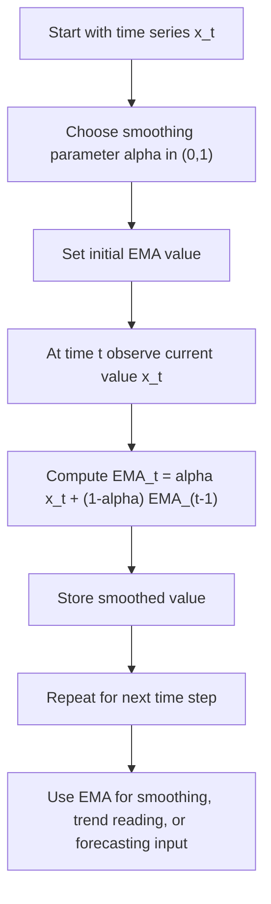

# Exponential Moving Average (EMA)

$$
\operatorname{EMA}_t = \alpha x_t + (1-\alpha)\operatorname{EMA}_{t-1}
$$

We are working on the Exponential Moving Average (EMA), with canonical formula $\operatorname{EMA}_t = \alpha x_t + (1-\alpha)\operatorname{EMA}_{t-1}$, where $x_t$ is the observed value at time $t$, $\alpha \in (0,1)$ is the smoothing parameter, and $\operatorname{EMA}_{t-1}$ is the previous exponentially smoothed value. The domain is time-series smoothing and short-horizon forecasting under ordered observations, where recent values should receive more weight than older ones.

## Deep Breakdown

The Exponential Moving Average (EMA) is a smoothing method for time series. Its main purpose is to reduce short-run noise while still reacting reasonably quickly to new data.

A plain raw series can be noisy:

- daily sales jump up and down,
- monthly unemployment claims fluctuate,
- weekly job vacancies move irregularly,
- customer demand shifts with random shocks.

If we look only at raw values, the signal can be hard to see. EMA solves this by building a smoothed series that blends:

- the newest observation,
- the previous smoothed estimate.

The recursive definition is:

$$
\operatorname{EMA}_t = \alpha x_t + (1-\alpha)\operatorname{EMA}_{t-1}
$$

This means:

- weight the current observation by $\alpha$,
- weight the previous EMA by $1-\alpha$,
- add them together.

Because the previous EMA already contains information from earlier periods, the EMA ends up giving positive weight to all past observations, but those weights decay exponentially over time. That is why it is called an **exponential** moving average.

A larger $\alpha$ means:

- more weight on the newest data,
- faster reaction,
- less smoothing.

A smaller $\alpha$ means:

- less weight on the newest data,
- slower reaction,
- more smoothing.

The expanded-weight form is:

$$
\operatorname{EMA}_t
=
\alpha x_t + \alpha(1-\alpha)x_{t-1} + \alpha(1-\alpha)^2 x_{t-2} + \cdots
$$

up to initialization effects. This shows clearly that older observations still matter, but their weights shrink geometrically.

EMA is widely used because it is:

- computationally cheap,
- recursive, so easy for streaming data,
- more responsive than a Simple Moving Average (SMA) with similar smoothing intent.

Why this matters in DA/DS:

- **Trend filtering:** helps reveal underlying movement in noisy time series.
- **Demand forecasting:** common baseline smoother in retail, labor, and operations data.
- **Monitoring dashboards:** useful for stabilizing KPI charts without waiting for long windows.
- **Streaming systems:** recursive update is efficient when new observations arrive one at a time.
- **Feature engineering:** EMA can be used as a lag-based smoothed feature for forecasting models.

## Flowchart

